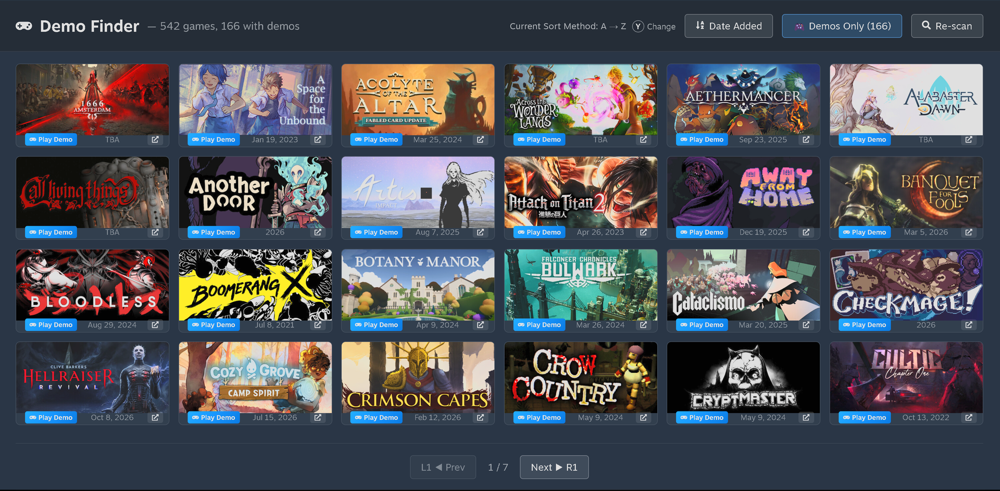

# Demo Finder (Decky Loader plugin)

Finds which games on your Steam wishlist have demos and lets you jump straight to them. Works on Steam Deck (Decky Loader) and Windows.

## Latest release: v1.3.1
- Fix: **Get Your Free API Key** now opens the Steam API key page on Steam Deck (it used to just close the Quick Access menu)
- v1.3.0 New: button prompts match your controller: **LB/RB + Y** (Xbox / Steam), **L1/R1 + Triangle** (PlayStation), **L/R + X** (Switch). Auto-detected, with a manual **Button Icons** override in the Quick Access menu
- v1.3.0 Fix: Windows external links (API key page) now open correctly; one zip works on Steam Deck and Windows
- v1.2.1: Play Demo badge and release dates no longer cut off on cards ("To be announced" now shows as TBA)
- v1.2.0: press **Y** (Triangle on PlayStation) to change the sort method, with an on-screen hint
- v1.1.0: selection highlight restored (controller **and** mouse) and L1 / R1 (LB / RB) page navigation fixed
- See [release notes](release-notes/v1.3.1.md) and the [Releases page](https://github.com/SilvertongueRED/decky-demo-finder/releases) for downloads

## Controls (full wishlist view)
| Input | Action |
|---|---|
| D-pad / stick / mouse hover | Highlight a card |
| **A** / click | Play demo (or open store page if there is no demo) |
| **X** / store icon on card | Open store page |
| **LB / RB** (PlayStation: L1 / R1, Switch: L / R) | Previous / next page |
| **Y** (PlayStation: Triangle, Switch: X) | Change sort method |

## Install
Download the latest zip from the [Releases page](https://github.com/SilvertongueRED/decky-demo-finder/releases), drop it into your plugins folder, and use the mod to get your Steam Wishlist API key for grabbing your wishlist! 

1. 

2. 

3. 

4. 

5. 

6. 

7. 

8. 

9. 
